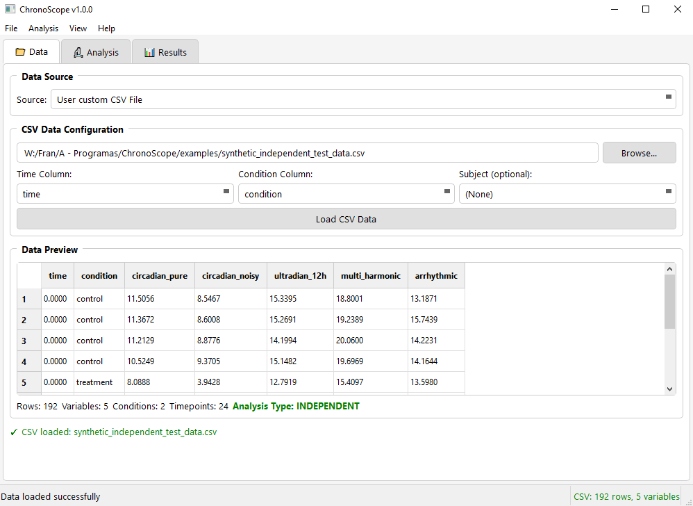
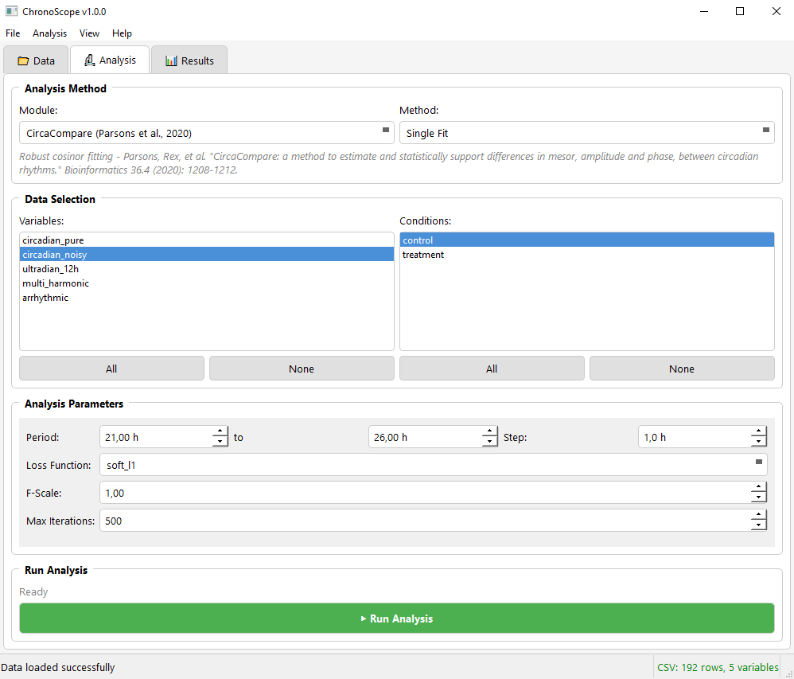
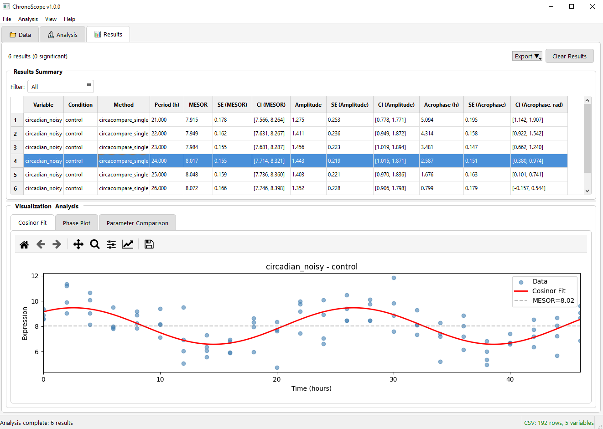

# ChronoScope

<p align="center">
  <strong>A Desktop Application for Multi-Method Circadian Rhythm Analysis</strong>
</p>

<p align="center">
  
  
  
  
</p>

<p align="center">
  <a href="#overview">Overview</a> •
  <a href="#key-features">Features</a> •
  <a href="#download">Download</a> •
  <a href="#installation-from-source">Installation</a> •
  <a href="#usage">Usage</a> •
  <a href="#data-preprocessing-optional">Preprocessing</a> •
  <a href="#analysis-modules">Modules</a> •
  <a href="#citation">Citation</a>
</p>

<p align="center">
  
  
  
</p>
<p align="center"><sub><em>Load data → configure & run an analysis → export publication-ready results.</em></sub></p>

---

## Overview

Choosing among the growing number of rhythm-detection methods — each with different assumptions and failure modes — is one of the biggest hurdles in circadian data analysis. ChronoScope solves this with a single cross-platform desktop app that bundles **ten established rhythm-detection algorithms** plus a novel ML consensus score (**CRS-AI**) behind a point-and-click interface, so no programming is required.

It's built for circadian biologists working with gene expression, protein abundance, locomotor activity, count data, or any uniformly sampled time series — with native support for CSV files, Drosophila activity monitors (DAM/TriKinetics), rodent wheel-running data (AWD/ClockLab), and the Rosbash circadian neuron scRNA-seq dataset.

## Key Features

- **No coding required** — point-and-click interface built with PySide6 (Qt)
- **Six integrated analysis modules** — CosinorPy, CircaCompare, RhythmCount, Classical Rhythm Analysis (10 algorithms), CRS-AI, and Locomotor Activity Analysis
- **Count-data support** — GLM-based cosinor fitting with five count distributions (Poisson, NB, ZIP, ZINB, Generalized Poisson)
- **Differential rhythmicity** — statistical comparison of cosinor parameters between conditions
- **CRS-AI** — Random Forest consensus score integrating outputs from multiple methods
- **Locomotor activity support** — native parsing of TriKinetics (DAM) and Actimetrics ClockLab (AWD) files (tabular activity data are also accepted), with dedicated actogram, chi-square periodogram, and activity-rhythm metrics
- **Optional preprocessing pipeline** — outlier removal, detrending, and smoothing filters, applied before the analysis modules (Locomotor Activity Analysis always uses the raw counts)
- **scRNA-seq support** — integrated loader for the Rosbash *Drosophila* clock neuron dataset
- **Publication-ready output** — PNG, SVG, PDF figures; CSV and Excel result tables

---

## Download

The easiest way to get started — no Python, no dependencies.

**[⬇ Download the latest release](https://github.com/FranTassara/ChronoScope/releases/latest)**

| Platform | What to grab | Run |
|---|---|---|
| Windows | `ChronoScope-windows.zip` | Unzip anywhere, then run `ChronoScope.exe` |
| macOS | `ChronoScope-macos.zip` | Unzip, then open `ChronoScope.app` |

> **macOS Gatekeeper note:** the app isn't notarized by Apple yet, so the first launch may be blocked. Right-click the app → **Open**, or run `xattr -cr ChronoScope.app` in Terminal, then open it normally.

📖 **[User Manual (PDF)](docs/ChronoScope_User_Manual.pdf)** — methods, parameters and output columns of every module.

---

## Installation from source

### Requirements

- Python 3.11 or higher (required by the pinned scikit-learn 1.8.0)
- See `requirements.txt` for the complete dependency list

### Steps

```bash
# Clone the repository
git clone https://github.com/FranTassara/ChronoScope.git
cd ChronoScope

# Create a virtual environment (recommended)
python -m venv venv
source venv/bin/activate       # Linux / macOS
venv\Scripts\activate          # Windows

# Install dependencies
pip install -r requirements.txt

# Launch the application
python main.py
```

### Running the tests

```bash
python -m unittest discover -s tests -t .
```

The suite uses the standard-library `unittest` and needs no dependencies beyond
the ones in `requirements.txt`. It checks that every module imports, that the
packaged CRS-AI model agrees with `core/feature_extraction.py`, that each method
still separates a synthetic 24 h rhythm from noise, and that the paths the
PyInstaller specs bundle still exist. It also holds regression tests for the
statistical behaviour of each module: DAM/AWD loading and the locomotor metrics,
preprocessing, CosinorPy fits and comparisons, the cross-variable q-values,
CircaCompare, RhythmCount, the Classical Rhythm Analysis methods and CRS-AI.

### Repository layout

| Path | Contents |
|---|---|
| `main.py`, `cli.py` | GUI entry point and headless batch interface |
| `core/` | Analysis engines (CosinorPy, CircaCompare, RhythmCount, classical methods, CRS-AI) |
| `core/models/` | Trained CRS-AI random forest and its feature metadata |
| `core/vendor/` | Third-party code bundled and imported at runtime |
| `ui/` | PySide6 panels and dialogs |
| `utils/` | Data loaders (CSV/Excel, DAM, AWD, Rosbash HDF5) and export |
| `examples/` | Example datasets, user templates and their generators |
| `data/` | Bundled datasets (Rosbash CLK856 scRNA-seq) |
| `scripts/` | One-off data preparation scripts |
| `validation/` | Validation scripts and reports supporting the manuscript |
| `docs/reference/` | Upstream documentation for the wrapped methods (not imported) |
| `tests/` | Test suite |

---

## Usage

### Quick Start

1. **Load data** — click *Browse…* to select a CSV file, or choose *DAM Monitor* / *Rosbash scRNA-seq* from the dataset selector.
2. **Map columns** — assign time, condition, and variable columns. The application auto-detects common column names.
3. **Select a module** — CosinorPy, CircaCompare, RhythmCount, Classical Rhythm Analysis, CRS-AI, or Locomotor Activity Analysis (the last one appears for DAM, AWD and tabular activity data).
4. **Run analysis** — set parameters (period, number of harmonics, etc.) and click *Run Analysis*.
5. **Export results** — summary tables (CSV / Excel) and figures (PNG / SVG / PDF) via the *Export* panel.

<details>
<summary><strong>CSV format & optional data sources</strong></summary>

#### CSV Format

```
time,condition,replicate,gene1,gene2,gene3
0,control,1,10.2,5.3,8.1
0,control,2,10.5,5.1,8.3
4,control,1,12.1,6.2,9.2
4,control,2,11.8,6.4,9.0
...
```

**Required columns:**
- `time` — numeric time in hours
- `condition` — group or treatment label
- One or more numeric variable columns

**Optional columns:**
- `replicate` — replicate identifier
- `subject` — subject/animal ID (any column name, e.g. `animal`, can be assigned to this role in the Data tab; required for the dependent/population-mean methods)

#### Locomotor Activity Files (DAM / AWD)

Load raw TriKinetics `.txt` DAM monitor files (*Drosophila* beam-break activity) or Actimetrics ClockLab `.awd` files (rodent wheel-running activity) directly. ChronoScope parses each format, bins/structures the data for downstream analysis, and unlocks the [Locomotor Activity Analysis module](#6-locomotor-activity-analysis-module) (actogram, chi-square periodogram, IS/IV, α/ρ, onset/offset).

#### Rosbash scRNA-seq Dataset

Preprocessed HDF5 file derived from:

> Ma D, Przybylski D, Bhinder T, et al. A transcriptomic taxonomy of *Drosophila* circadian neurons around the clock. *eLife* 2021;10:e63056.

Use the included `scripts/process_rosbash_dataset.py` script to generate the HDF5 file from the raw GEO data.

</details>

---

## Data Preprocessing (optional)

Before running any analysis module, each variable can be passed through an optional filter pipeline (`core/preprocessing.py`). Every stage is disabled by default and configured independently; when enabled, they always run in this order:

| Stage | Methods | Purpose |
|---|---|---|
| 1. Outlier removal | IQR · Z-score | Flags anomalous points and replaces them with NaN before fitting |
| 2. Detrending | Linear · Moving average · Polynomial | Removes slow, non-rhythmic trends while preserving the circadian oscillation |
| 3. Smoothing | Moving average · Savitzky–Golay · Butterworth (low-pass) | Reduces high-frequency noise |

Each condition is processed separately, or each subject when the dataset has a subject column. With replicated time points, detrending and smoothing filter the mean at each time point and add the correction to every replicate, so replicate scatter is kept. Stages that cannot be applied (e.g. too few time points) are listed in the message shown after the run. Preprocessing is not applied in Locomotor Activity Analysis, which always uses the raw activity counts, nor to the Rosbash scRNA-seq data; in both cases the message after the run says so.

This is useful for noisy locomotor activity traces or gene expression series with batch drift, before feeding the data into CosinorPy, RhythmCount, or Classical Rhythm Analysis.

---

## Analysis Modules

### 1. CosinorPy Module

Wraps the CosinorPy library (Moškon 2020) with a graphical interface for:

| Analysis | Description |
|---|---|
| Single-component cosinor | Fits M + A·cos(2πt/τ − φ) to a single group |
| Multi-component cosinor | Up to 6 harmonics for non-sinusoidal waveforms |
| Population-mean cosinor | Longitudinal/repeated-measures designs |
| Differential rhythmicity | Tests amplitude and acrophase differences (and MESOR in multi-component models) between every pair of conditions; q-values are Benjamini–Hochberg-adjusted across all the variables of a run |
| Poisson cosinor | Cosinor extension for count data (sequencing read counts) |

### 2. CircaCompare Module

Implements the CircaCompare framework (Parsons et al. 2020) for robust comparison of rhythm parameters between conditions. Supports five loss functions for outlier-resilient fitting:

`linear` · `soft_l1` · `huber` · `cauchy` · `arctan`

Outputs confidence intervals for MESOR, amplitude, and acrophase differences.

### 3. RhythmCount Module

Wraps the RhythmCount library (Velikajne et al. 2022) to fit cosinor models within a generalized linear model (GLM) framework for **count-valued time series** — RNA-seq read counts, neuronal spike counts, locomotor activity event tallies, or any non-negative discrete data where the Gaussian residual assumption of standard cosinor is violated.

Five count distributions are supported:

| Distribution | When to use |
|---|---|
| Poisson | Equidispersed counts (variance ≈ mean) |
| Generalized Poisson | Flexible dispersion (sub- or over-dispersed) |
| Negative Binomial | Over-dispersed counts (variance > mean); typical in RNA-seq |
| Zero-Inflated Poisson | Excess structural zeros + Poisson counts |
| Zero-Inflated Negative Binomial | Excess structural zeros + overdispersion |

**Five analysis methods** are available:

| Method | Description |
|---|---|
| Fit Single Model | Fits a user-specified distribution and harmonic complexity |
| Fit All Models | Grid search over all distribution × harmonic combinations |
| Fit Best Model | Automatic two-stage model selection (an F-test chooses the number of harmonics; AIC, BIC or a Vuong-type test chooses among models with the same number) |
| Parameter CIs | Approximate intervals for amplitude, MESOR and peaks from repeated 2/3 subsampling (descriptive; narrower than true 95% CIs) |
| Group Comparison | Independent best-model selection and CI estimation per group |

Goodness of fit is assessed via the likelihood ratio test (LLR p-value), AIC, BIC, and McFadden's pseudo-R². Amplitude, MESOR, and acrophase are extracted from the predicted curve after fitting.

### 4. Classical Rhythm Analysis Module

Ten algorithms available for period detection and rhythmicity testing:

| Method | Type | Best suited for |
|---|---|---|
| JTK Cycle | Nonparametric | Kendall's τ vs. a triangle waveform; independent (cross-sectional) data, no waveform assumption |
| AR-JTK | Nonparametric | JTK on ranks pre-whitened with an autoregressive model when the Ljung–Box test detects autocorrelation; dependent/longitudinal data |
| Cosine-Kendall | Nonparametric | Kendall's τ vs. a cosine template (assumes a symmetric waveform); independent data |
| Cosinor (OLS) | Parametric | OLS fit of MESOR/amplitude/acrophase with F-test; independent or pre-averaged data |
| Harmonic Cosinor | Parametric | OLS cosinor with up to 6 harmonics; complex/asymmetric waveforms |
| Fourier F24 | Effect size + permutation test | Target-period power vs. permutation noise, with the normalised F24 and permutation p-value (pF24) of Wijnen et al. (2006); pools two replicate series when available |
| Lomb–Scargle | Spectral | Unevenly sampled or missing time points; reports a false-alarm probability |
| Spectral Analysis (Periodogram) | Spectral | FFT-based power spectral density with interactive visualization; longitudinal data |
| Wavelet (CWT) | Time–frequency | Non-stationary rhythms; temporal changes in period and amplitude |
| Linear Mixed Effects | Hierarchical | Cosinor mixed model with random effects; repeated measures / grouped data |

### 5. CRS-AI (Consensus Rhythmicity Score)

A Random Forest classifier trained on synthetic and real circadian time series that aggregates feature vectors extracted from JTK Cycle, single-component cosinor, Lomb–Scargle and Fourier F24 into a single probability score (0–1). CRS-AI provides an integrated assessment that is more robust than any individual method alone, particularly for short or noisy time series.

The model was fitted on 4,532 of 5,649 labelled series (1,696 synthetic; 3,953 real transcriptomic series from mouse liver, *Drosophila* clock neurons and human blood) and evaluated on the remaining 1,117 (gene-grouped holdout, ROC-AUC 0.947) and on three external datasets never used in training (zebrafish 0.931, *Arabidopsis* 0.920, rat adipose tissue 0.792). Its labels are published computational classifications (BioCycle/RhythmicDB, the original studies' rhythmicity calls and curated gene lists), so the output is the probability of carrying the rhythmic reference label, not of genuine biological oscillation.

### 6. Locomotor Activity Analysis Module

Automatically enabled when the loaded dataset is a DAM (TriKinetics, *Drosophila*) or AWD (Actimetrics ClockLab, rodent) recording, or tabular (CSV/Excel) activity data spanning at least 24 h. Runs a full activity-rhythm characterization ("Activity Profile") in one pass:

| Output | Description |
|---|---|
| Double-plotted actogram | Population mean or individual (median-τ) actogram |
| Chi-square periodogram | Per-individual period (τ) estimation with a rhythmicity significance filter |
| Interdaily stability (IS) / Intradaily variability (IV) | Regularity of the rhythm across days vs. fragmentation within a day |
| α / ρ | Durations of the active (α) and rest (ρ) phases |
| Onset / offset | Activity onset and offset timing per cycle |

---

<details>
<summary><h2 style="display:inline">Methods reference (formulas & algorithm details)</h2></summary>

### Cosinor Model

$$Y(t) = M + A \cos\!\left(\frac{2\pi t}{\tau} - \varphi\right) + \varepsilon$$

| Symbol | Parameter | Description |
|--------|-----------|-------------|
| M | MESOR | Rhythm-adjusted mean (Midline Estimating Statistic Of Rhythm) |
| A | Amplitude | Half the peak-to-trough difference |
| φ | Acrophase | Time of peak in radians; converted to hours for output |
| τ | Period | Fixed (default 24 h) or estimated |
| ε | Residual | Assumed i.i.d. Gaussian |

Statistical significance is assessed via the zero-amplitude test (F-test on A = 0).

When a period range is set (Min ≠ Max, scanned in *Step* increments), the
Cosinor (OLS) and Harmonic Cosinor methods fit the model at every period of the
range and keep the best fit (lowest residual sum of squares). Because the
reported period is chosen after seeing all of them, the F-test *p*-value at that
period is optimistic. Both methods therefore report two columns: **p (raw)**, the
F-test at the winning period, and **p (Bonf adj)**, corrected for the number of
periods scanned (with a single period the two are equal). The two bracket the
truth — the raw value is anticonservative, while Bonferroni is conservative
because neighbouring candidate periods are strongly correlated rather than
independent tests. ChronoScope's "significant" counter and filter use the
corrected value for these two methods. The JTK-based methods (JTK, AR-JTK,
Cosine-Kendall) report one row per period instead, with *Best Fit* marking the
selected one, and their *p*-values are already adjusted for every template tested
over the whole range.

### RhythmCount GLM

$$\log(\mu_i) = \beta_0 + \sum_{k=1}^{N} \left[ \beta_{2k-1} \sin\!\left(\frac{2\pi k t_i}{\tau}\right) + \beta_{2k} \cos\!\left(\frac{2\pi k t_i}{\tau}\right) \right]$$

### JTK Cycle

A nonparametric procedure that:
1. Ranks the time series and computes Kendall's τ against a triangular reference waveform for every candidate period, phase and (optionally) asymmetry
2. Adjusts the best template's *p*-value for the number of templates tested (Bonferroni; the "p (BH adj)" column used for significance equals it unless several templates tie for the best *p*-value), or, with the *Empirical (permutation)* option, compares it with a permutation null of the maximum |τ| over all templates (Hutchison et al. 2015)
3. Returns estimated period, phase, and amplitude without assuming a sinusoidal shape

### Lomb–Scargle Periodogram

Evaluates spectral power at each candidate frequency using a least-squares projection, making it valid for unevenly sampled or gapped time series. Period is estimated at the frequency with maximum power; a *p*-value is derived from the false alarm probability.

### CRS-AI Feature Vector

For each time series, ChronoScope computes 18 descriptors from JTK Cycle, cosinor, harmonic cosinor, Lomb–Scargle and Fourier F24 (p-values, effect sizes, estimated periods, R², method agreement index, and relative amplitude). Eleven of them form the model's input vector; the remaining seven were dropped after their permutation importance on the holdout proved negligible, and are kept only for the method radar chart. That 11-feature vector is mapped to a rhythmicity probability by a pre-trained Random Forest (200 trees, max depth 10, balanced class weights) wrapped in isotonic probability calibration with 5-fold internal cross-validation, fitted on 4532 of 5649 labelled instances (3953 real, 1696 synthetic; the other 1117 form the holdout). Training and validation are reproducible from `validation/crs_ai/`.

### Output Parameters

| Parameter | Description | Units |
|-----------|-------------|-------|
| MESOR | Rhythm-adjusted mean | Same as input |
| Amplitude | Half peak-to-trough difference | Same as input |
| Acrophase | Time of peak | Hours |
| Period | Oscillation period | Hours |
| p-value | Test of zero amplitude (or equivalent) | — |
| R² | Goodness of fit | 0–1 |
| CRS score | Consensus rhythmicity probability | 0–1 |

</details>

---

## Citation

If you use ChronoScope in your research, please cite:

```bibtex
@article{tassara2025chronoscope,
  author  = {Tassara, Francisco},
  title   = {ChronoScope: A Desktop Application for Multi-Method Circadian Rhythm Analysis},
  journal = {},
  year    = {},
  doi     = {}
}
```

<details>
<summary>Please also cite the underlying methods used in your analysis</summary>

**CosinorPy:**
> Moškon M. (2020). CosinorPy: a Python package for cosinor-based rhythmometry.
> *Source Code for Biology and Medicine*, 15(1), 1–10.

**CircaCompare:**
> Parsons R, et al. (2020). CircaCompare: a method to estimate and statistically support
> differences in mesor, amplitude and phase, between circadian rhythms.
> *Bioinformatics*, 36(4), 1208–1212.

**RhythmCount:**
> Velikajne N, et al. (2022). RhythmCount: an R/Python package for circadian
> rhythmicity analysis of count data. DOI: to be confirmed upon publication.

</details>

---

## License

MIT License — see [LICENSE](LICENSE) for details.

## Dependencies

| Package | Version | Purpose |
|---------|---------|---------|
| PySide6 | ≥ 6.5 | GUI framework |
| NumPy | ≥ 1.24 | Numerical computation |
| pandas | ≥ 2.0 | Data handling |
| SciPy | ≥ 1.10 | Statistical tests, Lomb–Scargle |
| statsmodels | ≥ 0.14 | OLS/GLM and mixed-model fits, Ljung–Box test, FDR correction |
| matplotlib | ≥ 3.7 | Visualizations |
| CosinorPy | GitHub master (tested with 3.1) | Cosinor rhythmometry |
| seaborn | ≥ 0.13 | Required by CosinorPy |
| PyWavelets | ≥ 1.4 | Wavelet (CWT) analysis |
| h5py | ≥ 3.8 | Rosbash scRNA-seq dataset (HDF5) |
| scikit-learn | = 1.8.0 (pinned) | CRS-AI Random Forest (the version the model was trained with) |
| joblib | ≥ 1.3 | Loading the CRS-AI model |
| openpyxl · XlsxWriter | ≥ 3.1 | Excel import and export |

---

<p align="center">
  Developed for the circadian biology community · Francisco Tassara
</p>
